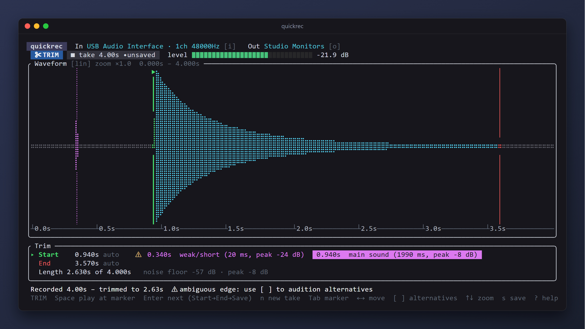

<div align="center">

# quickrec

**Record a sound, get a clean file. From the terminal, in seconds.**

quickrec records from your microphone or audio interface, cuts away the silence
before and after the sound, lets you audition the cut points on a waveform,
and saves the result as WAV or FLAC.

[](https://github.com/Cronkan/quickrec/releases/latest)
[](#requirements)
[](LICENSE)

### [⬇ Download for Windows](https://github.com/Cronkan/quickrec/releases/latest)



</div>

## Why quickrec

Capturing a one-shot sample, a voice line or a test tone usually means opening
a DAW, arming a track, recording, zooming in, trimming both ends and exporting.
quickrec turns that into a handful of keystrokes:

<div align="center">

**Space** record &nbsp;→&nbsp; **Enter** stop &nbsp;→&nbsp; **Enter** check the end &nbsp;→&nbsp; **Enter** save dialog &nbsp;→&nbsp; **Enter** saved

</div>

and one more **Enter** starts the next take.

## Features

- **Instant recording.** The input is always listening, so the first 0.4 s
  *before* you press Space is kept. You never clip the attack.
- **Automatic trim.** Silence is removed at both ends using the take's own
  noise floor, keeping natural decay and a few milliseconds of padding.
- **Ambiguous edges are flagged, not guessed.** A click, breath or bump before
  the real sound shows up as an alternative cut point (⚠). Step through them
  with `[` `]` and hear each one before you choose.
- **Audition everything.** Play from the active marker, preview just the kept
  edge or just the part being cut, or right-click anywhere on the waveform.
- **Precise waveform.** Zoom from the whole take down to single samples, in
  linear or dB view, with keyboard or mouse.
- **Clean exports.** 24-bit WAV or FLAC with a 3 ms fade at trimmed edges to
  avoid clicks.
- **Choose your devices and folder.** Pick input and output devices and browse
  to any save folder. quickrec remembers all of it.
- **One small file.** A single ~1.7 MB executable with no installer, runtime or
  dependencies.

## Getting started

1. Download `quickrec-<version>-windows-x64.zip` from the
   [latest release](https://github.com/Cronkan/quickrec/releases/latest) and unzip it anywhere.
2. Run `quickrec.exe`. Windows Terminal gives the best-looking result.
3. Press **Space** and make a sound. Press **Enter** when you're done.

> [!NOTE]
> quickrec is not code-signed yet, so Windows SmartScreen may warn the first
> time you run it. Choose **More info → Run anyway**. You can verify the
> download against the `.sha256` file attached to each release.

## How it works

quickrec has three modes. The badge in the top-left corner shows which one
you're in.

| Mode | Badge | <kbd>Space</kbd> | <kbd>Enter</kbd> |
|---|---|---|---|
| **Ready** | `READY` | start recording | n/a |
| **Record** | `● RECORD 0:03.21` | throw the take away and start over | stop and go to trim |
| **Trim** | `✂ TRIM` | play from the active marker (again to stop) | Start → End → Save dialog |

After saving, quickrec asks whether to **start a new recording** (Enter) or
**stay on this take** (Esc).

### Auto-trim in short

Each take is analysed in 10 ms frames. quickrec estimates the noise floor,
finds where the sound rises clearly above it, and extends the edges to catch
soft attacks and natural decay. If something short and quiet comes before the
main sound, quickrec keeps the main sound as the default start and lists the
earlier event as an alternative. You decide by listening.

## Keyboard reference

<details>
<summary><b>All keys</b> (press <kbd>?</kbd> in the app for the same list)</summary>

**Record**

| Key | Action |
|---|---|
| <kbd>Space</kbd> | record; while recording, restart the take |
| <kbd>Enter</kbd> / <kbd>Esc</kbd> | stop recording and go to trim |
| <kbd>n</kbd> | new recording (asks once if the take isn't saved) |
| <kbd>i</kbd> / <kbd>o</kbd> | choose input / output device |

**Listen**

| Key | Action |
|---|---|
| <kbd>Space</kbd> | play at the marker: Start → through the selection, End → last 2 s before the cut |
| <kbd>p</kbd> / <kbd>P</kbd> | play selection / whole take |
| <kbd>v</kbd> | preview the kept edge next to the active marker |
| <kbd>c</kbd> | preview the part being cut away |
| right-click | play from the mouse position |

**Trim**

| Key | Action |
|---|---|
| <kbd>Enter</kbd> | next step: Start → End → Save |
| <kbd>Tab</kbd> | switch between Start and End marker |
| <kbd>←</kbd> <kbd>→</kbd> | move marker (<kbd>Shift</kbd> 10% of view, <kbd>Ctrl</kbd> one sample) |
| <kbd>[</kbd> <kbd>]</kbd> | step through alternative cut points and preview each |
| <kbd>Home</kbd> | move marker to the very beginning / end |
| <kbd>a</kbd> | restore the automatic trim |
| drag | move the nearest marker (previews on release) |

**View**

| Key | Action |
|---|---|
| <kbd>↑</kbd> <kbd>↓</kbd> / <kbd>+</kbd> <kbd>-</kbd> | zoom around the active marker (mouse wheel zooms at the pointer) |
| <kbd>z</kbd> / <kbd>x</kbd> | fit the whole take / zoom to the selection |
| <kbd>g</kbd> | toggle linear / dB display |

**Save**

| Key | Action |
|---|---|
| <kbd>s</kbd> (<kbd>w</kbd> / <kbd>f</kbd>) | save dialog (with WAV / FLAC preselected) |
| <kbd>↑</kbd> <kbd>↓</kbd> | switch between the Name and Folder fields |
| <kbd>Enter</kbd> on Folder | browse folders and drives |
| <kbd>Tab</kbd> | switch format |
| <kbd>q</kbd> | quit (asks again if the take isn't saved) |

</details>

## Command line

```text
quickrec [OPTIONS]

  -o, --out <DIR>   folder to save recordings in (remembered)
  -r, --record      start recording immediately
  -l, --list        list audio devices and exit
  -h, --help        show help
```

Settings (devices, format, folder) are stored in `%APPDATA%\quickrec\config.txt`.

## Requirements

- Windows 10 or 11, 64-bit
- A terminal with Unicode support. [Windows Terminal](https://aka.ms/terminal)
  is recommended; the waveform uses Braille characters.
- Any input device Windows can record from: built-in mic, USB mic or audio interface.

## License

quickrec is released under the [MIT License](LICENSE). The download includes
`THIRD-PARTY-NOTICES.txt` with the licenses of the open-source components it
is built on.
